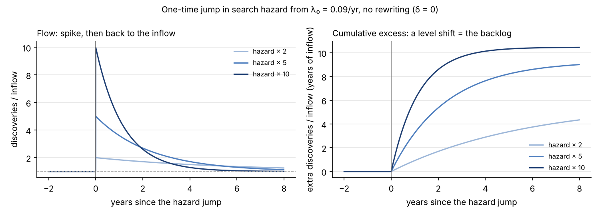
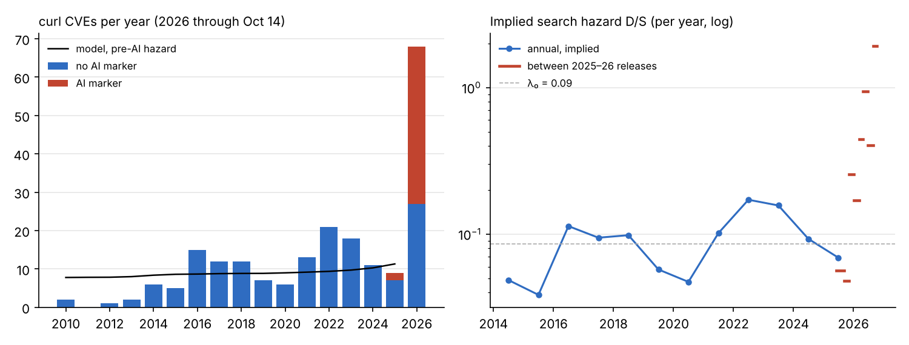
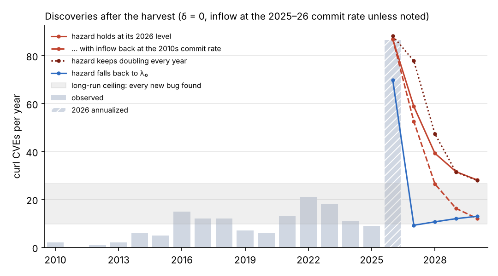
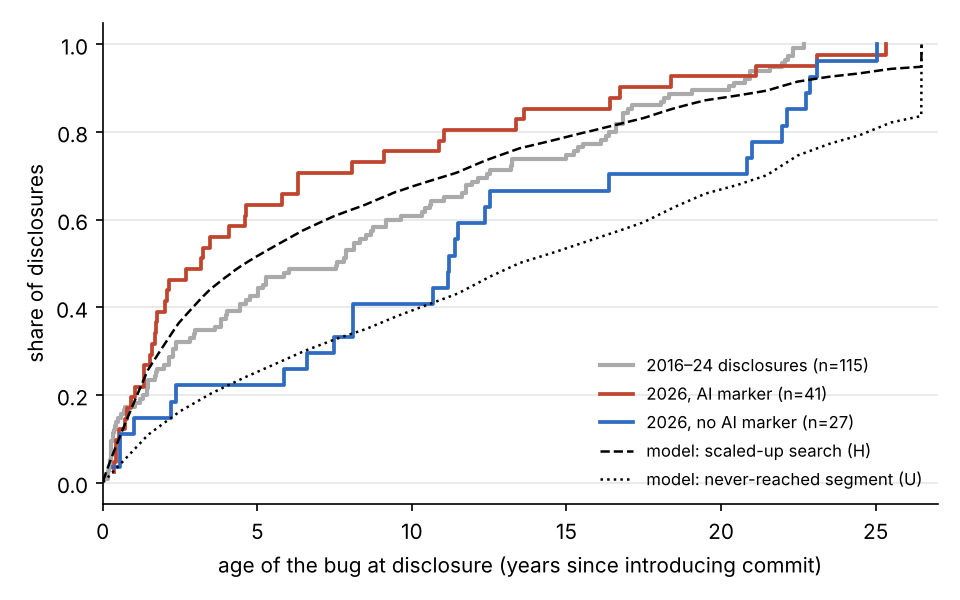

# Harvest or trend break? A stock-flow model of bug discovery, calibrated to curl

Tom Cunningham's note on
[LLMs' contribution to discovery](https://tecunningham.github.io/posts/2026-08-08-llm-contribution-to-discoveries.html)
looks for slope changes: has discovery sped up since about January 2026? A
jump in the flow of discoveries is consistent with two different worlds:

1. **A trend break.** AI permanently raises the rate at which new things are found.
2. **A harvest.** There was a stock of findable but unfound items (bugs,
   tractable open problems). Cheaper search works through that stock, and
   once it is gone the flow falls back to the rate at which new items appear.
   That rate may be set by humans writing code or posing questions.

A 2026-against-2025 comparison cannot tell these apart. This note writes the
second story down as a model, calibrates it to curl (where every CVE can be
dated back to the commit that introduced it), and asks what the data already
say about which world we are in.

This is interpretation, so it lives outside `problems/`. The register rules of
[FORMAT.md](../../FORMAT.md) don't apply, and the PNGs here are not drawn in
the pinned figure container.

## 1. The model

Latent bugs are introduced at rate $\kappa\, c(t)$, where $c$ is code inflow
(curl's commits per year). Each latent bug is found with hazard $\lambda(t)$,
or disappears unfound, when its code is rewritten, at rate $\delta$. With
stock $S$ and discoveries $D$:

$$\dot S = \kappa c - (\lambda + \delta) S, \qquad D = \lambda S .$$

It is the unemployment stock-flow model with search hazard in place of the
job-finding rate. Three properties do most of the work:

- **The long-run flow is pinned by inflow, not by search.** In steady state
  $D = \frac{\lambda}{\lambda+\delta}\,\kappa c$. Perfect search
  ($\lambda\to\infty$) raises the long-run flow by at most
  $(\lambda_0+\delta)/\lambda_0$, the inverse of the share of bugs humans
  would eventually have found. With $\delta = 0$ that factor is 1: AI finds
  the same bugs, only sooner.
- **A one-time jump in the hazard is a spike, not a trend.** If $\lambda$
  jumps from $\lambda_0$ to $\lambda_1$, $D$ jumps by $\lambda_1/\lambda_0$
  and decays back at rate $\lambda_1+\delta$. Cumulative discoveries get a
  level shift equal to the harvested backlog (left figure: the flow; right:
  the cumulative excess).
- **A hazard that keeps rising front-loads the harvest; it does not sustain
  it.** Only higher inflow (more code, for example AI-written code) or a large
  reservoir of bugs humans never reached keeps $D$ up for long.



So three things all get called "acceleration":
- a level shift in cumulative discoveries (the harvest);
- a permanent rise in the flow (a trend break);
- a rising growth rate of the flow, which is what recursive self-improvement
  would need.

Only the hazard $D/S$ is a clean measure of what changed in search.

## 2. Data

- **Bugs.** All 212 curl CVEs, from curl's own advisory record, as mirrored
  record by record into OSV's public bucket (read 2026-10-29; disclosures
  through 2026-10-14). Each record names the commit that introduced the
  flaw. Its committer date, read from a clone of `github.com/curl/curl`,
  gives the bug's vintage $v$ and its age at disclosure.
- **AI marker.** The repository's own classifier (`lib/credits.py`). Through
  2026-09-02 it gives 45 disclosures, 22 AI-marked, matching
  [problems/cyber-curl](../../problems/cyber-curl/README.md). The record now
  runs six weeks further: **68 CVEs in 2026, 41 AI-marked**, and the
  2026-10-14 release alone carried 23.
- **Inflow.** Commits per calendar year on curl's main branch. These ran at
  about 1,260/yr over 2010–19 and about 3,480/yr over 2025–26.

The 2026 release batches had 6, 4, 8, 18, 9 and 23 CVEs. The "Q3 dip" in the
quarterly series is release timing; the flow is still rising.

## 3. Calibration

**Pre-AI hazard.** Under a constant pre-AI hazard, the vintage of a bug
disclosed at $t$ has density proportional to
$c(v)\,e^{-(\lambda_0+\delta)(t-v)}$. That identifies
$\theta = \lambda_0 + \delta$ from disclosure ages alone, whatever the scale
of $\kappa$. The estimate is a conditional MLE over the 131 disclosures from
2010–24. curl's 1999 "Initial revision" commit imports earlier code in one
go, so it gets its own estimated weight.

- $\theta = 0.086$/yr (95% CI 0.056–0.120), so a bug lived about **12
  years** on average before disclosure.
- The pre-AI disclosure count then fixes $\kappa\lambda_0$. The fitted model
  runs at 7.8–11.3 disclosures a year over 2010–25 (black line, left panel
  below).
- $\delta$ is **not identified** from these data. The table shows
  $\delta = 0$ (every bug is eventually found) and $\delta = 0.05$ (5% of
  latent bugs a year are rewritten away unfound, so humans would ever find
  42% of them).

| | $\delta = 0$ | $\delta = 0.05$ |
|---|---|---|
| pre-AI hazard $\lambda_0$ | 0.086/yr | 0.036/yr |
| latent stock on 2026-01-01 | 139 bugs | 331 bugs |
| found in 2026 through Oct 14 | 68 (49% of that stock) | 68 (21%) |
| hazard, Jun 24 – Oct 14 2026 | 0.94/yr (10.9× $\lambda_0$) | 0.34/yr (9.4× $\lambda_0$) |
| hazard, last interval (to Oct 14) | 1.93/yr | 0.66/yr |
| half-life of the excess flow at the Jun–Oct hazard | 9 months | 22 months |

**Implied hazard.** The right panel replays every disclosure batch since 2010
through the model. Between consecutive batches it solves for the constant
hazard that finds exactly that batch out of the latent stock: the same move
as backing job-finding rates out of unemployment stocks and flows. Over
2014–24 the implied hazard wanders between about 0.04 and 0.17. Through 2026
it climbs, unevenly, to roughly 20× $\lambda_0$ in the last interval.



## 4. What it predicts

Annual curl CVEs, from the stock left after 2026-10-14. Each 2026 figure is the
68 observed plus the model for the rest of the year.

| scenario | 2026 | 2027 | 2028 | 2029 | 2030 |
|---|---|---|---|---|---|
| **$\delta = 0$**, hazard holds at its Jun–Oct level | 87 | 59 | 39 | 32 | 28 |
| … inflow back at the 2010s commit rate | 87 | 53 | 27 | 16 | 12 |
| … hazard keeps doubling every year | 88 | 78 | 47 | 31 | 28 |
| … hazard falls back to $\lambda_0$ | 70 | 9 | 11 | 12 | 13 |
| **$\delta = 0.05$**, hazard holds | 91 | 89 | 78 | 71 | 65 |
| … hazard keeps doubling every year | 92 | 136 | 159 | 125 | 81 |
| … hazard falls back to $\lambda_0$ | 71 | 12 | 13 | 14 | 15 |



What the table says:
- **Your reversion story is the $\delta = 0$ rows.** About half the backlog
  is already gone. Even if the hazard stays where it is, the flow falls by a
  third in 2027. It settles at the inflow: about 27/yr if curl keeps
  committing at its 2025–26 pace, or about 10–12/yr at its 2010s pace. That
  is a level shift plus whatever extra code is being written, not a trend
  break.
- **If AI use stopped, there would be a hangover.** The flow would drop
  *below* the old rate (9 in 2027), because the bugs that would normally have
  surfaced were found early.
- **2027–28 are the test.** With $\delta = 0$ no hazard path keeps the flow
  up: even a hazard that doubles every year gives 78 in 2027 and 47 in 2028.
  With $\delta = 0.05$ a steady hazard keeps it near 80–90 through 2028.
  A count that stays near 2026 levels into 2028 would therefore mean a large
  reservoir of bugs humans would never have found. In that case the
  long-run flow genuinely rises, by up to the inverse of the human find share
  (about 2.4× at $\delta = 0.05$).

## 5. The age test

The model also separates two kinds of AI search:

- **(H) Scaled-up ordinary search.** The same hazard increase applies to
  every vintage, so the bugs found right after the jump have the age profile
  of the existing stock. That stock is young, because recent code has had
  little exposure. Predicted median age in mid-2026: 4.6 years (7.1 if inflow
  is held at its pre-2024 rate).
- **(U) A never-reached segment.** AI opens a class of bugs that humans
  effectively never found. That class has accumulated since curl began, so
  its bugs are old: predicted median 13.5–15.5 years with $\delta = 0$.

| disclosures | n | median age | mean | older than 10 years |
|---|---|---|---|---|
| 2016–24 | 115 | 7.6 | 8.5 | 39% |
| 2026, all | 68 | 6.1 | 8.4 | 38% |
| 2026, AI marker | 41 | 3.2 | 6.2 | 24% |
| 2026, no AI marker | 27 | 11.2 | 11.9 | 59% |



Fitting a mixture of (H) and (U) to each group's 2026 ages gives the
following weight on the never-reached segment (95% profile intervals):

| | inflow = commits, $\delta=0$ | inflow flat from 2024, $\delta=0$ | inflow = commits, $\delta=0.05$ |
|---|---|---|---|
| all 2026 | 0.04 (0–0.42) | 0.00 (0–0.20) | 0.34 (0–1) |
| AI marker | 0.00 (0–0.23) | 0.00 (0–0.15) | 0.00 (0–0.61) |
| no AI marker | 0.73 (0.10–1) | 0.40 (0–0.99) | 1.00 (0.25–1) |

- **The AI-credited finds look like scaled-up search, skewed young.** At a
  median of 3.2 years they are younger than (H) predicts under either inflow
  measure. 32 of the 41 come from
  one firm (Aisle Research), and the profile fits scanners working through
  recently changed code. They do not look like AI opening an old,
  unreachable class.
- **The finds without an AI credit are old.** 8 of the 27 are over 20 years
  old, and 12 of the 27 are Medium severity, against 3 Medium and 1 High
  among the 41 AI-marked. With 27 bugs the
  interval is wide. Uncredited AI use would explain them as easily as a
  surge of human attention.
- **OpenSSL points the same way.** Using the oldest affected release line as
  a lower bound on age, the 2026 bugs are not older than usual:

| OpenSSL disclosures | 2021 | 2022 | 2023 | 2024 | 2025 | 2026 |
|---|---|---|---|---|---|---|
| n | 8 | 12 | 19 | 9 | 6 | 39 |
| median lower-bound age (years) | 4.5 | 1.2 | 8.0 | 5.6 | 3.0 | 4.8 |
| share reaching back to 1.0.2 (2015 code) | 50% | 33% | 53% | 33% | 33% | 28% |

Taken together: so far this looks like a large, still-rising increase in
ordinary search intensity working through a finite stock. That is the
harvest story. Whether the stock is small ($\delta \approx 0$, flow back near
the inflow by 2028–29) or large is the open question, and the 2027 count
answers it.

## 6. Implications for the note's framing

- **Measure hazards, not counts.** Where there is a denominator, the clean
  statistic is $D/S$:
  - remaining open problems on the closed lists (Hilbert, Millennium, Smale,
    Green, TOPP, Erdős);
  - a latent stock backed out from ages, as here.

  A count must eventually fall on a closed list however good search gets.
- **The welfare gain is in exposure time, not in counts.** The expected time
  a curl bug stays latent, $1/(\lambda+\delta)$, has fallen from about 12
  years to between 1 and 2.5 at the Jun–Oct 2026 hazard, depending on
  $\delta$. That gain persists after the count
  returns to normal. A permanently higher count would be bad news: more bugs
  being written.
- **It suggests a fifth answer to "why some domains more than others."** The
  size of a harvest scales with the backlog, and backlogs build up where
  human search cost more than the items were worth: Low-severity bugs in old
  code, obscure Erdős problems. Contested frontiers (Stockfish, Gurobi,
  nanoGPT, ω) were already worked at the margin by experts, so they had
  little backlog to harvest.

## 7. Caveats

- **Inflow proxy.** Commits stand in for new latent bugs. curl's commits
  doubled over 2024–26, partly as fixes for the very reports modelled here.
  The flat-inflow column above is the check.
- **Vintages.** The "introducing commit" is the one curl's maintainers name.
  Bugs blamed on the 1999 import are lumped, with an estimated weight.
- **$\delta$** is assumed, and the size and duration of the harvest depend on
  it.
- **Proportional hazard across vintages** is assumed. The young skew of the
  AI-marked finds suggests the AI hazard is vintage-specific.
- **Disclosure is not discovery.**
  - curl batches CVEs at releases.
  - Maintainer triage capacity can throttle disclosures. A binding capacity
    constraint would stretch a harvest out over time, and the implied hazard
    would understate search intensity.
- **Severity.** Every CVE counts the same. Most AI-marked curl CVEs are rated
  Low.
- **Scope.** This is one project; OpenSSL is only a lower-bound
  cross-check.

## Reproduce

```bash
git clone --filter=tree:0 --no-checkout https://github.com/curl/curl /tmp/curl
python3 analysis/depletion/curl_ages.py /tmp/curl
python3 analysis/depletion/model.py
```

- `curl_ages.py` writes `curl-bug-ages.csv` (one row per CVE: disclosure
  date, introducing commit and its date, age, severity, AI marker, finders)
  and `curl-commits-by-year.csv`.
- `model.py` (needs numpy and matplotlib) prints every number above and
  draws the four `depletion-*.png` figures.
