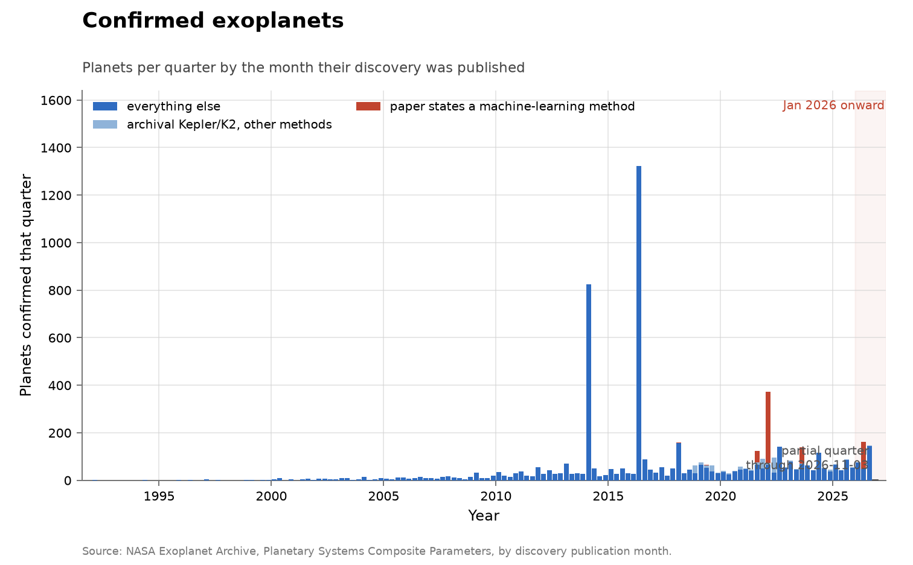
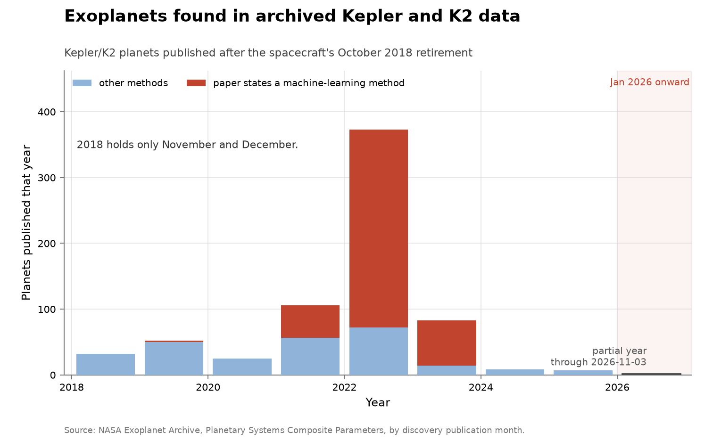
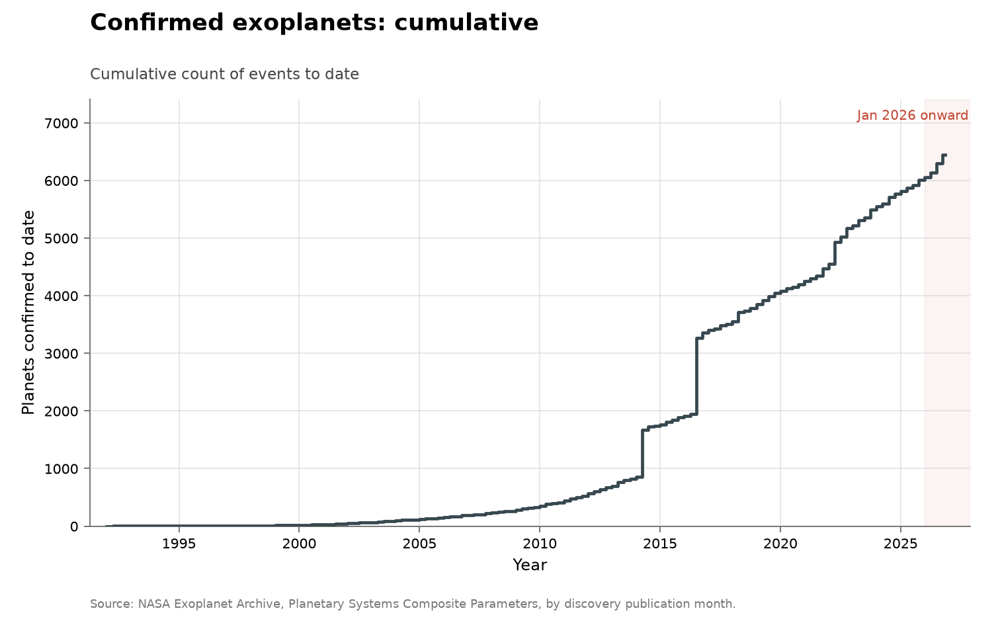

# Confirmed exoplanets

- **Domain:** outside the three domains
- **Role:** discovery series
- **Metric:** confirmed planets per quarter by the month their discovery was published, split into planets from a paper whose own title or abstract states a machine-learning method, Kepler/K2 planets published after the spacecraft's retirement by any other method, and everything else
- **Coverage:** 1992–2026, monthly publication dates rolled up by quarter, partial through 2026-11-03
- **Data:** per-planet ledger [`exoplanets-confirmed.csv`](exoplanets-confirmed.csv); quarterly [`exoplanets-by-quarter.csv`](exoplanets-by-quarter.csv); annual [`exoplanets-by-year.csv`](exoplanets-by-year.csv); the machine-learning paper register [`exoplanets-ai-papers.csv`](exoplanets-ai-papers.csv)
- **Upstream:** <https://exoplanetarchive.ipac.caltech.edu/> (TAP query of the `pscomppars` table at <https://exoplanetarchive.ipac.caltech.edu/TAP/sync>)
- **Verdict:** inconclusive — 385 confirmations published through 2026-11-03 annualize to about 458 against 251 in 2025 and a 280/year mean over 2023–2025; one paper holds 114 of the 385

## Definition

The NASA Exoplanet Archive keeps one row per confirmed planet in its
Planetary Systems Composite Parameters table, with the discovery's
publication month (`disc_pubdate`), the facility that made it, and the
discovery reference [@nasa2026exoplanetarchive]. A counted event is one
confirmed planet, dated by that publication month.

Two flags split the count:

- **archival Kepler/K2.** The discovery facility is Kepler or K2 and the
  discovery was published in November 2018 or later. NASA announced the
  spacecraft's retirement on 30 October 2018, so these planets were found
  in data that was already in the archive.
- **machine-learning paper.** The discovery reference is one of the papers
  in [`exoplanets-ai-papers.csv`](exoplanets-ai-papers.csv), each of which
  states a machine-learning method in its own title or abstract (quoted under
  AI attribution).

Every planet sits in exactly one band: a register paper first, then archival
Kepler/K2, then everything else.

> NASA’s Kepler space telescope has run out of fuel needed for further
> science operations. NASA has decided to retire the spacecraft within its
> current, safe orbit, away from Earth. [...] “We know the spacecraft’s
> retirement isn’t the end of Kepler’s discoveries,” said Jessie Dotson,
> Kepler’s project scientist at NASA’s Ames Research Center
> — NASA, news release “NASA Retires Kepler Space Telescope, Passes Planet-Hunting Torch”, 2018-10-30, read 2026-11-03 [@nasa2018keplerretires]

## Facts

- **rows:** 6,451 confirmed planets published 1992-01 to 2026-10
- **by-year (2016–2025):** 2016: 1484 · 2017: 153 · 2018: 293 · 2019: 235 ·
  2020: 168 · 2021: 308 · 2022: 665 · 2023: 333 · 2024: 255 · 2025: 251
- **2026 (through 2026-11-03):** 385 planets; annualizes to about 458
- **2026 concentration:** Lafarga et al. 2026 accounts for 114 of the 385
- **archival Kepler/K2:** 688 planets published from November 2018 on, 423 of
  them (61%) from register papers; the peak year is 2022 with 373
- **machine-learning register:** 538 planets across 6 papers, 8.3% of all
  confirmed planets; the largest is Valizadegan et al. 2022 with 301

The collection-wide [cumulative index](../../CUMULATIVE.md) redraws the
quarterly confirmations as a running total:

## Method

[`fetch.py`](fetch.py) runs one TAP query for the name, discovery year,
publication month, method, facility and reference of every row of
`pscomppars`, strips the reference's HTML link to its citation text and ADS
bibcode, sets the two flags, and writes the ledger and its quarterly and
annual rollups. Planets published after the snapshot date are dropped. The
fetch stops if any planet lacks a `YYYY-MM` publication month or if a
register paper matches no planet.

The register is hand-maintained. A paper enters it when its own title or
abstract, read on arXiv, states a machine-learning method; its row keeps the
quoted text, the arXiv link, the read date, and how the arXiv paper was
matched to the archive's reference. The five papers with titles naming deep
learning or machine learning were found by searching the archive's
references for authors of known machine-learning validation work; the sixth
(Lafarga et al. 2026) was found by reading the abstract behind the largest
2026 reference.

[`figure.py`](figure.py) draws the quarterly count with the shared
`periodic_stacked()` shape: everything else in human blue, archival Kepler/K2
by other methods in the softer blue, and register papers in the AI red. A
second chart draws only the archival Kepler/K2 planets per year from 2018 on.
The axes are linear, and January 2026 onward is shaded, as in every figure
here. [`check.py`](check.py) recomputes the fact lines above and checks that
each register quote appears below.

## Limitations

- **publication month is not observation date.** A planet is dated when its
  discovery paper appeared, which can follow the data by years; only the
  archival flag separates old data from new.
- **large validation papers make the series lumpy.** A single paper can
  validate hundreds of planets at once, and the biggest quarters in the
  series are such batches, with or without machine learning.
- **the archival flag covers Kepler and K2 only.** TESS, CoRoT and
  ground-based archives also yield planets from old data, and those are not
  flagged.
- **the machine-learning register is a floor.** It holds the papers checked
  so far; the archive's other references were not read, and a paper that
  used machine learning without saying so in its title or abstract is not in
  it.
- **"states a machine-learning method" is not "found by AI alone".** The
  register papers combine learned classifiers with statistical validation
  and human vetting; the flag records the method a paper names, not a share
  of credit.
- **one register match rests on metadata.** Lafarga et al. 2026 is matched to
  arXiv 2603.22597 by first author, year and journal; the planet counts
  differ (the archive credits 114 planets, the abstract states 118 newly
  validated).

## AI attribution

Each register paper, with the text that places it in the register, read on
arXiv on 2026-11-03:

### Shallue & Vanderburg 2018 — 2 planets
- **bibcode:** 2018AJ....155...94S
- **arXiv:** [1712.05044](https://arxiv.org/abs/1712.05044)
- **matched by:** arXiv title matches the archive reference

> Identifying Exoplanets with Deep Learning: A Five Planet Resonant Chain around Kepler-80 and an Eighth Planet around Kepler-90
> — Shallue & Vanderburg 2018, arXiv 1712.05044, title, read 2026-11-03

### Dattilo et al. 2019 — 2 planets
- **bibcode:** 2019AJ....157..169D
- **arXiv:** [1903.10507](https://arxiv.org/abs/1903.10507)
- **matched by:** arXiv title matches the archive reference

> Identifying Exoplanets with Deep Learning II: Two New Super-Earths Uncovered by a Neural Network in K2 Data
> — Dattilo et al. 2019, arXiv 1903.10507, title, read 2026-11-03

### Armstrong et al. 2021 — 50 planets
- **bibcode:** 2021MNRAS.504.5327A
- **arXiv:** [2008.10516](https://arxiv.org/abs/2008.10516)
- **matched by:** arXiv title matches the archive reference

> Exoplanet Validation with Machine Learning: 50 new validated Kepler planets
> — Armstrong et al. 2021, arXiv 2008.10516, title, read 2026-11-03

### Valizadegan et al. 2022 — 301 planets
- **bibcode:** 2022ApJ...926..120V
- **arXiv:** [2111.10009](https://arxiv.org/abs/2111.10009)
- **matched by:** arXiv title matches the archive reference

> ExoMiner: A Highly Accurate and Explainable Deep Learning Classifier that Validates 301 New Exoplanets
> — Valizadegan et al. 2022, arXiv 2111.10009, title, read 2026-11-03

### Valizadegan et al. 2023 — 69 planets
- **bibcode:** 2023AJ....166...28V
- **arXiv:** [2305.02470](https://arxiv.org/abs/2305.02470)
- **matched by:** arXiv title matches the archive reference

> Multiplicity Boost Of Transit Signal Classifiers: Validation of 69 New Exoplanets Using The Multiplicity Boost of ExoMiner
> — Valizadegan et al. 2023, arXiv 2305.02470, title, read 2026-11-03

### Lafarga et al. 2026 — 114 planets
- **bibcode:** 2026MNRAS.548ag512L
- **arXiv:** [2603.22597](https://arxiv.org/abs/2603.22597)
- **matched by:** first author, year and journal match the archive reference; the archive credits 114 planets to it and the abstract states 118 newly validated

> RAVEN detects candidates with a box least squares algorithm, classifies them into transiting planets and false positives using machine learning models trained with realistic simulations, and performs statistical validation.
> — Lafarga et al. 2026, arXiv 2603.22597, abstract, read 2026-11-03

## Sources

- [@nasa2026exoplanetarchive] — the `pscomppars` table every count here
  aggregates, with its discovery publication month, facility and reference.
- [@nasa2018keplerretires] — the retirement date the archival flag starts
  from, quoted under Definition.
- The six arXiv records quoted under AI attribution, one per register paper.
- [ADDITIONAL-CANDIDATES.md](../../ADDITIONAL-CANDIDATES.md) — the backlog
  design (separate new data from better inference on old data) the archival
  flag implements.
