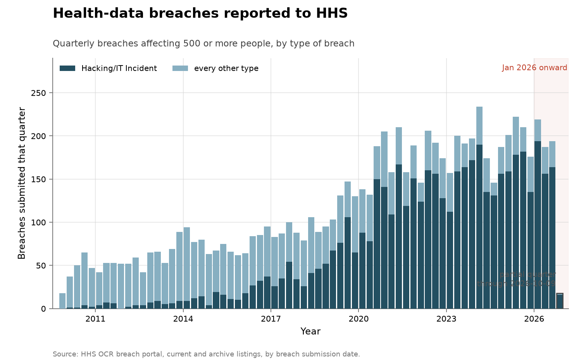
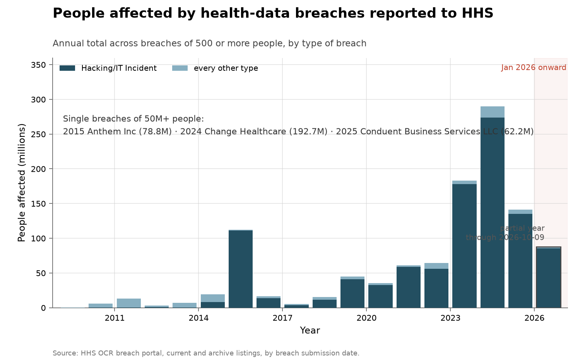
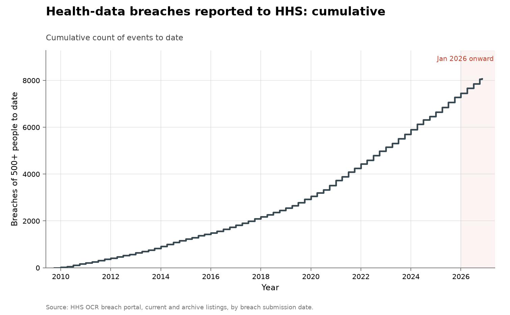

# Health-data breaches reported to HHS

- **Domain:** vulnerabilities
- **Role:** context: harm
- **Metric:** breaches of unsecured protected health information affecting 500 or more people, reported to HHS per quarter by submission date, split into Hacking/IT Incident and every other breach type, with the people affected
- **Coverage:** 2009–2026, from the portal's first listed breach (October 2009), quarterly, partial through 2026-10-09
- **Data:** per-breach ledger [`hhs-breaches.csv`](hhs-breaches.csv); quarterly [`hhs-breaches-by-quarter.csv`](hhs-breaches-by-quarter.csv); annual [`hhs-breaches-by-year.csv`](hhs-breaches-by-year.csv)
- **Upstream:** <https://ocrportal.hhs.gov/ocr/breach/breach_report.jsf> (current and archive listings, each with a CSV export)
- **Verdict:** no acceleration — 530 Hacking/IT Incident breaches through 2026-10-09 annualize to about 686 against 654 in 2025 and a 624/year mean over 2023–2025

## Definition

The HHS Office for Civil Rights publishes reported breaches of unsecured
protected health information that affected 500 or more people on its breach
portal [@hhs2026breachportal]. The portal splits them into two
listings:

> This page lists all HIPAA breaches reported within the last 24 months that are currently under investigation by the Office for Civil Rights.
> — HHS Office for Civil Rights, Breach Portal, current listing, read 2026-11-03 [@hhs2026breachportal]

> This page archives all resolved HIPAA breach reports and/or reports older than 24 months.
> — HHS Office for Civil Rights, Breach Portal, archive listing, read 2026-11-03 [@hhs2026breachportal]

A counted event is one listed breach, dated by its breach submission date.
The split uses the portal's "Type of Breach" field: a breach whose type
includes "Hacking/IT Incident" is counted there, and every other type
(unauthorized access or disclosure, theft, loss, improper disposal, other)
is counted together. The people-affected figures are the "Individuals
Affected" the reporting entity stated.

## Facts

- **rows:** 8,071 breaches submitted 2009-10-21 to 2026-10-09; 759 from
  the current listing and 7,312 from the archive
- **all types by year:** 2009: 18 · 2010: 199 · 2011: 200 · 2012: 218 ·
  2013: 277 · 2014: 314 · 2015: 270 · 2016: 328 · 2017: 358 · 2018: 369 ·
  2019: 511 · 2020: 663 · 2021: 715 · 2022: 718 · 2023: 745 · 2024: 741 ·
  2025: 809
- **hacking by year:** 2010: 8 · 2011: 17 · 2012: 17 · 2013: 29 · 2014: 39 ·
  2015: 56 · 2016: 114 · 2017: 149 · 2018: 165 · 2019: 314 · 2020: 457 ·
  2021: 546 · 2022: 568 · 2023: 607 · 2024: 612 · 2025: 654
- **hacking share:** 4% of 2010's breaches and 81% of 2025's
- **2026 (through 2026-10-09):** 618 breaches, 530 of them Hacking/IT
  Incident; the hacking count annualizes to about 686
- **people affected:** 1,106 million across all rows, 91% of them in
  Hacking/IT Incident breaches
- **largest years:** 2024: 290.1 million people; 2023: 183.3 million
- **largest breach:** Change Healthcare, Inc., 192,700,000 people, submitted
  2024-07-19, 66% of 2024's total

The collection-wide [cumulative index](../../CUMULATIVE.md) redraws the
quarterly breaches as a running total:

## Method

[`fetch.py`](fetch.py) reads both listings from the portal. The portal is a
JavaServer Faces application with no plain export URL, so the script replays
the steps a browser takes: it opens the report page through the front page's
"View HIPAA Breach Reports" link, submits the listing's "Export as CSV"
control, switches to the archive tab and exports again. Controls are found
by their labels rather than by their generated identifiers. The script stops
if a column header moves, if either export is empty, or if any breach
appears in both listings. It keeps every column but the free-text web
description, drops breaches submitted after the snapshot date, and writes the
ledger with a `listing` column recording which listing each row came from,
then the quarterly and annual rollups.

[`figure.py`](figure.py) draws the quarterly counts with the shared
`periodic_stacked()` shape, Hacking/IT Incident under every other type, in
the dark and light ends of the collection's severity ramp: the split is a
harm category, and no breach report names who found the flaw. A second chart
draws people affected per year in millions with the same split, and its note
names every single breach that affected 50 million people or more. The axes are linear, and January 2026 onward is shaded, as
in every figure here. [`check.py`](check.py) recomputes the fact lines above
and checks that the rollups sum to the ledger.

## Limitations

- **only breaches of 500 or more people are listed.** Smaller breaches do
  not appear on the portal.
- **only HIPAA-covered health data is in scope.** The series says nothing
  about breaches outside health care or of other kinds of data.
- **dates are submission dates.** A breach is dated when it was reported to
  HHS, which can follow the breach itself by months, and the listing lags
  submissions, so the latest weeks are incomplete.
- **"Hacking/IT Incident" is not "exploited vulnerability".** The category
  includes ransomware, phishing that compromised an account, and network
  intrusions; the portal does not record the access method or any CVE.
- **people affected is the reporting entity's own count.** It can be revised
  after submission, and one large breach can dominate a year.
- **rows are reports, not incidents.** The ledger keeps the listing's rows
  as they are and does not merge rows that may describe one incident, such
  as a business associate's breach listed under several covered entities.

## AI attribution

The portal records breach type and location, not who carried out a breach
or how. No AI attribution appears in either listing as of the 2026-11-03
read [@hhs2026breachportal].

## Sources

- [@hhs2026breachportal] — the current and archive listings every row is
  read from, and the listing descriptions quoted under Definition.
- Sibling series:
  [all software: vulnerabilities known exploited](../cyber-kev-exploited/README.md)
  counts exploited CVEs, the flaw end of the same pipeline;
  [FBI Internet Crime Complaint Center](../cyber-ic3-losses/README.md)
  counts ransomware complaints and reported losses, a different harm unit.
