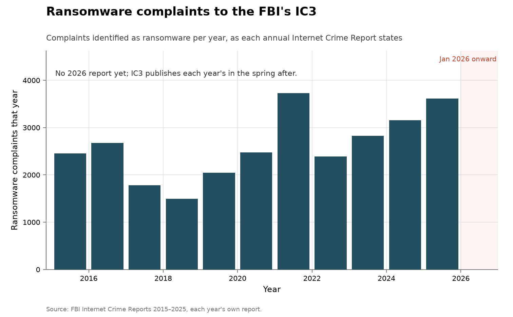
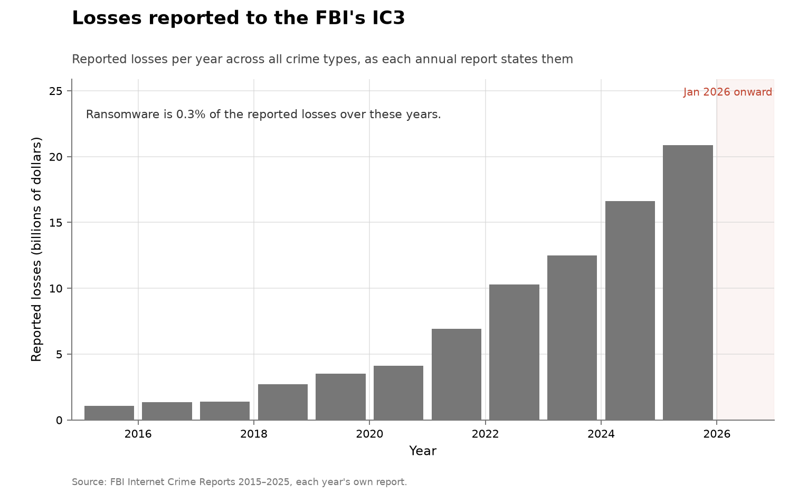
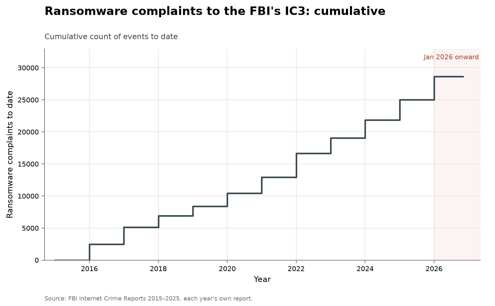

# FBI Internet Crime Complaint Center: ransomware and reported losses

- **Domain:** vulnerabilities
- **Role:** context: harm
- **Metric:** complaints identified as ransomware per year to the FBI's Internet Crime Complaint Center, with ransomware losses and total reported losses across all crime types, one value per year as that year's annual report states it
- **Coverage:** 2015–2025, one row per annual report; annual cadence; reports read 2026-11-03
- **Data:** [`ic3-by-year.csv`](ic3-by-year.csv)
- **Upstream:** <https://www.ic3.gov/AnnualReport/Reports> (one PDF per year, `https://www.ic3.gov/AnnualReport/Reports/<year>_IC3Report.pdf`)
- **Verdict:** too early — the 2026 report is due in 2027; 3,611 ransomware complaints in 2025 against 3,156 in 2024 and a 2,502/year mean over 2015–2024

## Definition

The FBI's Internet Crime Complaint Center (IC3) takes complaints from victims
of internet-enabled crime and publishes an annual Internet Crime Report
[@fbi2026ic3]. Each report tabulates complaints and reported losses by crime
type, with ransomware as one row.

The counted event here is one complaint identified as ransomware in the year
of the report. The two dollar columns are what complainants reported losing:
ransomware losses from the crime-type loss table, and total reported losses
across every crime type from the report's own headline figure. Neither is an
estimate of the cost of ransomware or of cybercrime; the reports say what
the ransomware figure leaves out:

> Regarding ransomware adjusted losses, this number does not include
> estimates of lost business, time, wages, files, or equipment, or any
> third-party remediation services acquired by an entity. In some cases,
> entities do not report any loss amount to FBI, thereby creating an
> artificially low overall ransomware loss rate. Lastly, the number only
> represents what entities report to FBI via IC3 and does not account for
> the entity directly reporting to FBI field offices/agents.
> — FBI Internet Crime Complaint Center, 2024 Internet Crime Report, footnote to the crime-type loss table, read 2026-11-03 [@fbi2026ic3]

Total reported losses span every crime type the reports tabulate, most of
them frauds that involve no software flaw. The tables record neither how a
ransomware attacker gained access nor which vulnerability, if any, was used.

## Facts

- **rows:** 11 annual reports, 2015–2025
- **ransomware complaints by year:** 2015: 2,453 · 2016: 2,673 ·
  2017: 1,783 · 2018: 1,493 · 2019: 2,047 · 2020: 2,474 · 2021: 3,729 ·
  2022: 2,385 · 2023: 2,825 · 2024: 3,156 · 2025: 3,611
- **ransomware losses:** $32.3 million in 2025 against $12.5 million in
  2024; the largest year is 2023 at $59.6 million
- **ransomware share of losses:** 0.3% of all reported losses over
  2015–2025
- **total losses:** $20.88 billion in 2025 against $1.07 billion in 2015
- **complaints:** 1,008,597 in 2025, the most of any year here

The collection-wide [cumulative index](../../CUMULATIVE.md) redraws the
ransomware complaints as a running total:

## Method

There is no `fetch.py` in this folder. Each row is transcribed by hand from
that year's report, read as a PDF from the upstream listing. The ransomware
columns come from the row labelled Ransomware in the report's two crime-type
tables, by complaint count and by complaint loss. The total-loss column comes
from the report's headline statement for its own year, and the
`losses_as_stated` column keeps that statement's wording verbatim; for 2015
it is the totals row of the victims-by-age table, the only place that report
states an exact annual total. `source` and `source_url` name the report for
every row. [`check.py`](check.py) recomputes the fact lines above and checks
that each `losses_usd` value is the figure its `losses_as_stated` text states.

Later reports restate earlier years in five-year comparison tables, sometimes
with different rounding (the 2022 report's five-year chart puts 2020 at $4.2 billion
where the 2020 report says "exceeding $4.1 billion"). Each row here uses its own year's
report only.

[`figure.py`](figure.py) draws the ransomware complaints as one bar per year
in the darkest severity-ramp colour, and the total reported losses as one
grey bar per year in billions of dollars; the grey marks the totals as the
agency's own figures, most rounded to the nearest $0.1 billion. The axes are
linear, and January 2026 onward is shaded, as in every figure here, though
no row reaches it.

## Limitations

- **complaints are a sample, not a census.** A complaint exists only when a
  victim files one with IC3; the quoted footnote states that reports made
  directly to FBI field offices are not counted.
- **the loss columns understate cost.** Ransomware losses exclude lost
  business, recovery and remediation, per the quoted footnote, and many
  complaints report no loss.
- **the total is not a vulnerability measure.** Reported losses span every
  crime type; the folder keeps them as scale for the ransomware figures,
  not as a harm attributable to software flaws.
- **the ransomware row counts complaints, not attacks.** Nothing in the
  tables links a complaint to the vulnerability or access method used.
- **the rounding differs by year.** 2015's total is exact to the dollar;
  most later totals are stated to $0.1 billion and several as "exceeding" a
  rounded figure.
- **the series is annual and lags.** The report for a year appears in the
  spring after it, so no 2026 value exists at this read.

## AI attribution

The crime-type tables record neither the attacker's method nor its tooling.
No AI attribution appears in the ransomware rows of the 2015–2025 reports as
of the 2026-11-03 read [@fbi2026ic3].

## Sources

- [@fbi2026ic3] — the 2015–2025 Internet Crime Reports every row is
  transcribed from, and the footnote quoted under Definition.
- Sibling series:
  [all software: vulnerabilities known exploited](../cyber-kev-exploited/README.md)
  splits CISA's exploited-vulnerability catalogue by its known-ransomware-use
  flag, a per-CVE count rather than a complaint count;
  [health-data breaches reported to HHS](../cyber-hhs-breaches/README.md)
  counts breaches and people affected, a different harm unit.
