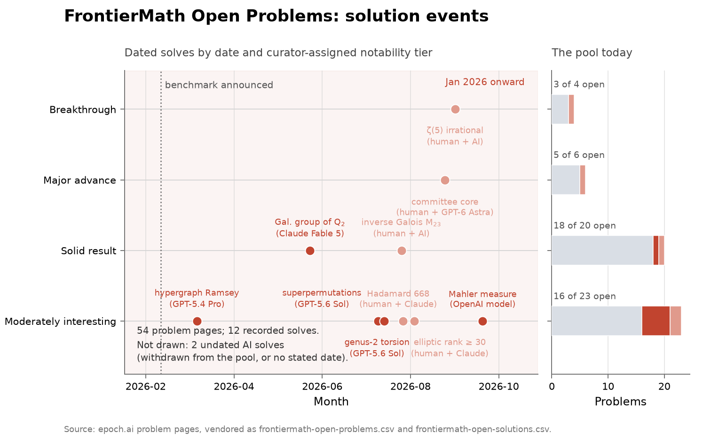
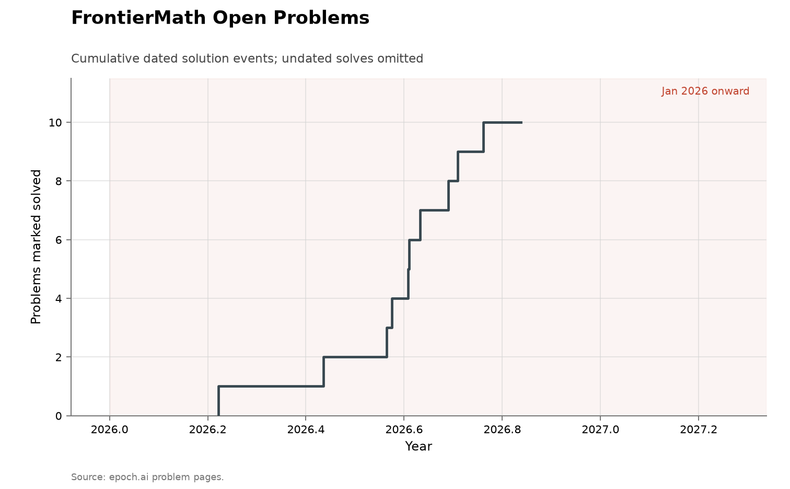

# FrontierMath Open Problems

- **Domain:** mathematics
- **Role:** discovery series
- **Metric:** dated solution events on Epoch AI's pool of open research problems, placed by curator-assigned notability tier
- **Coverage:** benchmark announced 2026-02-26; pages read 2026-11-03, with recorded solves from 2026-03-23 to 2026-10-06
- **Data:** [`frontiermath-open-problems.csv`](frontiermath-open-problems.csv), [`frontiermath-open-solutions.csv`](frontiermath-open-solutions.csv)
- **Upstream:** <https://epoch.ai/frontiermath/open-problems>
- **Verdict:** too early — 10 dated solves between 2026-03-23 and 2026-10-06; the pool was announced 2026-02-26 and no prior-year rate exists

## Definition

FrontierMath: Open Problems is Epoch AI's pool of unsolved research
mathematics, announced in late February 2026 [@epoch2026openproblems]. The
site's front page states the selection:

> "A collection of unsolved mathematics problems that have resisted serious
> attempts by professional mathematicians."
> — Epoch AI, FrontierMath: Open Problems front page, read 2026-08-14 [@epoch2026openproblems]

Computational verification is an admission criterion:

> "Problems are only included if their solutions can be verified
> computationally. This lets us evaluate AI systems at scale without
> requiring humans to read AI-generated proofs each time."
> — Epoch AI, FrontierMath: Open Problems FAQ, read 2026-08-14 [@epoch2026openproblems]

Each problem carries an editorial notability tier — moderately interesting,
solid result, major advance, breakthrough. The FAQ defines the lowest tier's
floor:

> "Moderately Interesting: The problem was posed at least 10 years ago and
> has been worked on by at least two independent teams of mathematicians. It
> has connections to broader questions, but is not a priority for any large
> research program."
> — Epoch AI, FrontierMath: Open Problems FAQ, read 2026-08-14 [@epoch2026openproblems]

A "discovery" in this series is a problem page moving to a solved status:
solved by AI, solved by humans, or solved by humans and AI together, a
status the site added after the first two:

> "While we initially marked this problem as being solved by humans, we have since introduced a new “human + AI” solution status."
> — Epoch AI, inverse-galois problem page, read 2026-11-03 [@epoch2026openproblems]
 Solve dates come from the pages'
solution-update prose and Epoch's announcement posts: the ramsey-hypergraphs
row is dated by the announcement post because its page states no solve date,
the hadamard row by the day of the public report its page links, and the
withdrawn explicit-deformations row and the genus-2-rational-points row
carry no date. The pool is edited as
events arrive: problems are added, retired after solves, and in one case
withdrawn.

## Facts

- **pages:** 54 problem pages in the sitemap read of 2026-11-03; 7 marked solved by AI, 5 by humans and AI together, 0 by humans, 42 unsolved
- **tiers:** 23 moderately interesting · 20 solid result · 6 major advance · 4 breakthrough; 1 withdrawn page badged Novel example
- **events:** 12 recorded solves; 10 carry a date, running 2026-03-23 to 2026-10-06
- **placement:** 7 solves in moderately interesting, 2 in solid result, 1 on the Novel-example page; 1 in major advance and 1 in breakthrough
- **front-page tally:** AI solves of 3/22, 1/18, 0/6 and 0/3 across the four tiers, under the headline "Recently expanded to 50 problems", read 2026-08-14

The front-page tally differs from the page-by-page sitemap read the CSVs
vendor, consistent with recent additions, retirement of solved rows from
the active pool, and the withdrawal. The
[Erdős catalogue](../math-erdos/README.md) records the same
one-stock-several-counts pattern on its corpus.

The collection-wide [cumulative index](../../CUMULATIVE.md) redraws the ten
dated events as a running count:

### ramsey-hypergraphs — A Ramsey-style Problem on Hypergraphs
- **event:** solved_ai
- **date:** 2026-03-23
- **system:** GPT-5.4 Pro
- **elicited by:** Kevin Barreto and Liam Price
- **tier:** Moderately interesting
- **notes:** First AI solve on the benchmark; confirmed by problem contributor Will Brian; dated by Epoch's announcement since the page states no solve date

> "This problem has been solved! A solution was first elicited by Kevin
> Barreto and Liam Price, using GPT-5.4 Pro. This solution was confirmed by
> problem contributor Will Brian, and will be written up for publication."
> — Epoch AI, ramsey-hypergraphs problem page, read 2026-08-14 [@epoch2026openproblems]

### explicit-deformations — Explicit Deformations of Algebras
- **event:** solved_ai
- **date:**
- **system:** GPT-5.2 Pro
- **elicited by:** David Turturean
- **tier:** Novel example

> "The solution was generated by GPT-5.2 Pro running in a harness developed
> by David Turturean."
> — Epoch AI, explicit-deformations problem page, read 2026-08-14 [@epoch2026openproblems]

> "Update (2026-03-12): We have determined that any solution to this problem
> would not meet our bar of being a publishable result in its own right. As
> a result, we have removed the problem from the benchmark."
> — Epoch AI, explicit-deformations problem page, read 2026-08-14 [@epoch2026openproblems]

### q2-absolute-galois — A Presentation of the Absolute Galois Group of \(\mathbb{Q}_2\)
- **event:** solved_ai
- **date:** 2026-06-09
- **system:** Claude Fable 5
- **elicited by:** David Roe
- **tier:** Solid result
- **notes:** GPT-5.5 Pro independently reproduced the solution on 2026-06-24 in a harness by David Turturean; write-up by Roe and Turturean

> "Progress Update (2026-07-06): Multiple AI systems have now generated
> solutions that are accepted by the verifier for this problem. The first
> solution we were made aware of was generated by Claude Fable 5, elicited
> by problem contributor David Roe on 2026-06-09."
> — Epoch AI, q2-absolute-galois problem page, read 2026-08-14 [@epoch2026openproblems]

### superpermutations — Short Superpermutations over 8, 9, and 10
- **event:** solved_ai
- **date:** 2026-07-26
- **system:** GPT-5.6 Sol
- **elicited by:** William Echols
- **tier:** Moderately interesting
- **notes:** Building on Uku Raudvere's same-day n=8 post; verified in Epoch pre-release testing 2026-07-27 and recorded solved on release

> "Since the superpermutations problem appears to have been solved by AI
> after we accepted the problem into the benchmark, we are recording this
> problem as solved on release."
> — Epoch AI, superpermutations problem page, read 2026-08-14 [@epoch2026openproblems]

### genus-2-jacobian-torsion — A Genus 2 Curve over the Rationals with a Rational Torsion Point of Prime Order at Least 31
- **event:** solved_ai
- **date:** 2026-07-30
- **system:** GPT-5.6 Sol
- **elicited by:** Epoch pre-release test
- **tier:** Moderately interesting
- **notes:** Found an existing curve of Costa and Keller by literature search; recorded solved on release with order 37 set as the next target

> "In this instance, the solution to the problem was latent in the existing
> literature: the curve, which is part of a substantial project to create a
> dataset of curves, is in a public database, and would have been recognized
> as a solution had someone checked its torsion subgroup."
> — Epoch AI, genus-2-jacobian-torsion problem page, read 2026-08-14 [@epoch2026openproblems]

### inverse-galois — The Inverse Galois Problem for the Mathieu Group \(M_{23}\)
- **event:** solved_human_ai
- **date:** 2026-08-11
- **system:** Claude Fable 5, Claude Opus 4.8, ChatGPT 5.6 Sol
- **elicited by:** Huang et al.
- **tier:** Solid result
- **notes:** First scored human; moved to the human + AI status the site introduced in autumn 2026, since the authors' comments make AI instrumental

> "Since comments from the authors make it clear that AI was instrumental in solving this problem, we have updated its status with this new label."
> — Epoch AI, inverse-galois problem page, read 2026-11-03 [@epoch2026openproblems]

> "We hold a high bar for considering a problem “solved by AI”, in
> particular requiring that the core ideas of the solution be unambiguously
> contributed by AI."
> — Epoch AI, inverse-galois problem page, read 2026-08-14 [@epoch2026openproblems]

> "The boundaries between the human- and AI-contributed reasoning are not
> clear. Probably, it would be practically impossible to draw a sharp line."
> — author of the \(M_{23}\) solution, quoted on Epoch AI's inverse-galois problem page, read 2026-08-14 [@epoch2026openproblems]

### hadamard — Hadamard Matrix of Order 668
- **event:** solved_human_ai
- **date:** 2026-08-12
- **system:** Claude
- **elicited by:** Levent Alpöge and a team of three humans
- **tier:** Moderately interesting
- **notes:** Provisionally marked solved by AI pending detail on the human share; the construction encodes Hadamard matrices of all previously unknown admissible orders up to 2000; the status chip reads Solved (human + AI) at the 2026-11-03 refetch while the page text still says provisionally solved by AI

> "We have provisionally marked the problem as being solved by AI, though
> will revise this if further reports from the team indicate that humans
> contributed significantly to the core mathematical ideas."
> — Epoch AI, hadamard problem page, read 2026-08-14 [@epoch2026openproblems]

### elliptic-curve-rank — Elliptic Curves over \(\mathbb{Q}\) of Large Rank
- **event:** solved_human_ai
- **date:** 2026-08-20
- **system:** Claude
- **elicited by:** Levent Alpöge and Ava Howell
- **tier:** Moderately interesting
- **notes:** The problem asked for rank at least 30; ICARM leaderboard curve #273 reached it on 2026-08-20 credited to Claude with Alpöge and Howell in the submitting account's commentary; self-reported with no paper as of the 2026-09-14 refetch; the same team posted a rank ≥ 31 curve on 2026-08-23; the status chip reads Solved (human + AI) at the 2026-11-03 refetch while the page text still says solved by AI

The same event is this collection's
[elliptic-curve rank record](../math-elliptic-rank/README.md), where the
submission history, the leaderboard rows and the self-reported status of
the credit are documented in full.

### genus-2-rational-points — Many Rational Points on a Genus-2 Curve
- **event:** solved_ai
- **date:**
- **system:** GPT-6 Astra
- **elicited by:** Epoch pre-release evaluation
- **tier:** Moderately interesting
- **notes:** Marked Solved (AI) at the 2026-09-14 refetch; the page later states GPT-6 Astra found a genus-2 curve with 648 rational points in a pre-release evaluation, above Elkies–Stoll's 642; the page states no date

> "First solved by: GPT-6 Astra In a pre-release evaluation on FM:OP, GPT-6 Astra found a genus-2 curve with 648 rational points."
> — Epoch AI, genus-2-rational-points problem page, read 2026-11-03 [@epoch2026openproblems]

### committee-election — The Core in Approval-Based Committee Elections
- **event:** solved_human_ai
- **date:** 2026-09-10
- **system:** GPT-6 Astra
- **elicited by:** Patrick Becker, Matthias Greger and Dominik Peters
- **tier:** Major advance
- **notes:** Dated by arXiv 2609.11912; the authors attribute the primary idea and proof to GPT-6 Astra in a lengthy interactive session; the core is shown never empty, so the problem was unsolvable as stated and is marked solved under Epoch's policy

> "The authors attribute the primary idea and proof to GPT-6 Astra and a “lengthy interactive session”. Peters conveyed to us that he doubts that the team would have found the proof without Astra, but also that Astra does not appear to be capable of solving the problem out of the box with a simple prompt. As such, we mark this as a human + AI solution."
> — Epoch AI, committee-election problem page, read 2026-11-03 [@epoch2026openproblems]

### apery-irrationality — Apéry-Style Irrationality Proofs via Linear Recurrences
- **event:** solved_human_ai
- **date:** 2026-09-17
- **system:**
- **elicited by:** Aabir Fauzan
- **tier:** Breakthrough
- **notes:** zeta(5) proved irrational, dated by the Zenodo preprint (record 22826419) with a Lean formalization; not Apery-style but marked solved under Epoch's policy; the page names no AI system; Catalan's constant, another target, proved irrational in OpenAI's 2026-10-06 release

> "The most natural target for this problem — showing that \(\zeta(5)\) is irrational — has been achieved! [...] We believe this solution meets our criteria for being marked as “human + AI”, and will update if more information becomes available. Update: On October 6, 2026, OpenAI released hundreds of new results in mathematics due to an internal model. In one preprint, they prove that Catalan’s constant is irrational, solving another target of this problem."
> — Epoch AI, apery-irrationality problem page, read 2026-11-03 [@epoch2026openproblems]

### large-mahler-measure — Littlewood Polynomials with Large Normalized Mahler Measure
- **event:** solved_ai
- **date:** 2026-10-06
- **system:** internal OpenAI model
- **elicited by:** OpenAI
- **tier:** Moderately interesting
- **notes:** Dated by OpenAI's release of hundreds of mathematics results; the preprint proves ultraflat real Littlewood polynomials exist, which gives normalized Mahler measure arbitrarily close to one

> "On October 6, 2026, OpenAI released hundreds of new results in mathematics. In one preprint, they prove the existence of ultraflat real Littlewood polynomials. This implies that there are Littlewood polynomials with normalized Mahler measure arbitrarily close to one. Therefore, we are marking this problem as solved by AI."
> — Epoch AI, large-mahler-measure problem page, read 2026-11-03 [@epoch2026openproblems]

## Method

[`fetch.py`](fetch.py) reads the site's sitemap, fetches each problem page,
and rebuilds [`frontiermath-open-problems.csv`](frontiermath-open-problems.csv)
from the server-rendered status chip, field chip, task-type chips and
notability badge; an unrecognised status is a hard failure rather than a
guessed category.
[`frontiermath-open-solutions.csv`](frontiermath-open-solutions.csv) is
hand-transcribed from the pages' solution-update prose and Epoch's
announcement posts, because the dates, systems and elicitors of each solve
are stated only in prose. [`check.py`](check.py) cross-checks the two
ledgers — every solved status in the page ledger must have an event row and
vice versa — and recomputes the fact lines and register entries, so a
refetch that flips a status without the event ledger being reviewed fails
the folder rather than passing silently.

[`figure.py`](figure.py) places each dated event at its date and tier lane,
and beside the timeline draws the whole pool as one stacked bar per tier —
open, solved by AI (AI red), solved by humans and AI together (the softer
AI red), solved by humans — with each bar's label stating how
much of the tier remains unsolved. Undated solves — the withdrawn explicit-deformations page and the
genus-2-rational-points page — are stated in a corner note rather than
drawn.
It also draws the cumulative count of dated solves for
[CUMULATIVE.md](../../CUMULATIVE.md).

## Limitations

- **no baseline.** The pool is eight months old and there is no pre-2026
  series; no rate comparison against earlier years is possible.
- **machine-checkable selection.** Computational verification is an
  admission criterion, and the FAQ states the resulting bias:

  > "Does the verifiability constraint introduce a bias to the kinds of
  > math represented here? Yes. The problems have a constructive bent,
  > asking for concrete mathematical objects or algorithms."
  > — Epoch AI, FrontierMath: Open Problems FAQ, read 2026-08-14 [@epoch2026openproblems]

- **moving denominator.** Problems are added, retired on solving, and in
  one case withdrawn; the front-page tally and the sitemap disagree, and
  this folder's page count is one day's read of a moving pool.
- **solve dates are announcement dates.** Pre-release solves are dated by
  when Epoch tested or announced them, not when a model first produced the
  answer; two solves have no recoverable date at all.
- **the AI/human line is an editorial call, and it moves.** The site added
  a human + AI status after its first solves and moved three earlier rows
  into it: inverse-galois from human, hadamard and elliptic-curve-rank from
  AI. On the last two the page text still reads as solved by AI while the
  status chip reads human + AI; the register records both.
- **a solve can answer the problem in a form it did not ask for.** The
  committee-election solve shows the requested object cannot exist, and the
  apery-irrationality solve proves ζ(5) irrational by a method that is not
  Apéry-style; the site marks both solved under its policy (quoted above).
- **tier denominators are small.** The top two tiers hold 6 and 4 rows, so
  tier-level shares rest on single-digit denominators.

## AI attribution

7 of the 12 recorded solves are credited to AI systems in the event ledger and 5 to humans and AI together. Solved by AI: GPT-5.4 Pro
(ramsey-hypergraphs), Claude Fable 5 (q2-absolute-galois), GPT-5.6 Sol
(superpermutations and genus-2-jacobian-torsion), an internal OpenAI model
(large-mahler-measure), one solve on the withdrawn explicit-deformations
page for which the event ledger records no date and no system, and
GPT-6 Astra on genus-2-rational-points, found in a pre-release evaluation
on a date the page does not state. Solved by humans and AI
together: inverse-galois (Claude Fable 5, Claude Opus 4.8 and ChatGPT 5.6
Sol), hadamard and elliptic-curve-rank (Claude), committee-election
(GPT-6 Astra), and apery-irrationality, whose page names no AI system
[@epoch2026openproblems]. The genus-2-jacobian-torsion solve is a
literature-search result: the page states the solving curve was already in
a public database (quoted above). The top two tiers now hold one solve
each, both human + AI: committee-election in major advance and
apery-irrationality in breakthrough, as of the 2026-11-03 read.

## Sources

- [@epoch2026openproblems] — the pool, its criteria, every status and tier
  in the page ledger, and the solution-update prose quoted in the register.
- [@arxiv2026horizonmath] — a second 2026 benchmark whose design states
  that discovery is hard while "verification is computationally efficient
  and simple" (its bibliography note); cited as the contemporaneous
  instance of the same admission criterion.
- [@erdosproblems2026wiki] — the AI-contribution record on the neighbouring
  Erdős corpus, frozen 2026-06-30.
- [@tao2026interview] — the 2026-03-20 interview quoted in
  [math-erdos](../math-erdos/README.md) on catalogue-scale solve counts.
- Ledgers over related corpora: the
  [Erdős catalogue](../math-erdos/README.md), the
  [Erdős top-10](../math-erdos-top10/README.md),
  [Ben Green's list](../math-green/README.md) — two of this pool's rows
  (no-three-in-line, Chowla's cosine problem) appear on Green's list — and
  the [Smale ledger](../math-smale/README.md), another list scored one
  status event at a time.
